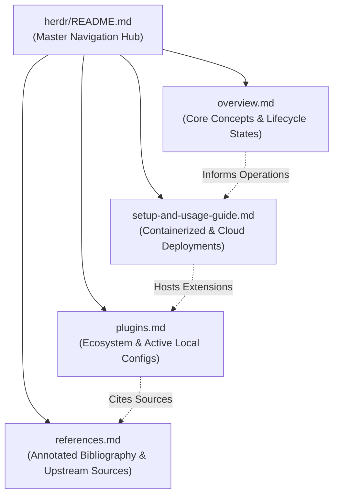

# Herdr Knowledge Base

> Comprehensive research topic, architecture analysis, cloud deployment guide, and plugin catalog for **Herdr** — the mouse-first terminal workspace manager for AI coding agents.

This knowledge base conforms to the **AgentWikis** (`llms.txt`) documentation standard. It is structured with dense informational content, clean frontmatter, and contextual cross-linking to serve both human engineers and AI coding agents.

---

## 1. Topic Navigation & Document Index

| Document | Type | Summary & Key Topics Covered |
|---|---|---|
| [**Overview & Architecture**](overview.md) | `concept` | High-level introduction, client-daemon architecture, core primitives (sessions, workspaces, tabs, panes, agents), deep dive into the 5 agent lifecycle states (`idle`, `working`, `blocked`, `done`, `unknown`), and the bottom-buffer detection engine. |
| [**Setup & Cloud Workspace Guide**](setup-and-usage-guide.md) | `guide` | Production deployment guide strictly focused on **containerized and cloud workspaces** (Docker, Docker Compose, Coder, cloud dev environments). Covers unprivileged security (`developer` user), headless server operation (`herdr server`), socket configuration (`HERDR_SOCKET_PATH`), SSH remote machine federation, and VS Code / Cursor remote workflows. |
| [**Plugins & Extensions Catalog**](plugins.md) | `catalog` | Architecture of Herdr plugins (manifests, argv execution, environment variables), the 5-minute safety vetting checklist, catalog of top 10 community plugins (Reviewr, Zoetrope, Agent Usage, etc.), and deep-dive technical audit of the user's active local plugins (`herdr-web-ui`, `herdr-radar`, `auto-title`, `memex`, `agent-router`, `reviewr`) and native agent hooks (Claude Code, Antigravity CLI). |
| [**References & Sources**](references.md) | `reference` | Annotated bibliography with source URLs, author attributions, and scope notes for official Herdr docs, Datalumina guides, Bitdoze marketplace analyses, and local system configurations. |

---

## 2. Topic Architecture & Conceptual Flow



---

## 3. Quick Reference & Command Cheat Sheet

### Essential CLI Commands

```bash
# Discovery & Status
herdr status server               # Show running daemon status
herdr --version                   # Print version
herdr api schema --json           # Export full JSON Schema for socket API

# Topology Management
herdr workspace list              # List workspaces in current session
herdr workspace create --cwd $PWD # Create workspace for current directory
herdr tab create --label logs     # Create a new tab
herdr pane split --direction right # Split focused pane vertically
herdr pane list                   # List all active panes

# Agent Interaction
herdr agent list                  # List all recognized agents and their live states
herdr agent get <name>            # Inspect agent metadata and turns
herdr agent prompt <name> "msg" --wait # Prompt agent and wait for settled state
herdr agent read <name> --lines 50 # Read unwrapped terminal output

# Headless Server & Configuration
herdr server                      # Run as headless daemon (for containers/supervisors)
herdr server stop                 # Gracefully stop daemon and running panes
herdr server reload-config        # Reload config.toml without interrupting panes
herdr server update-agent-manifests # Fetch latest agent detection rules

# Remote & Multi-Machine Control
herdr --remote ssh://user@host    # Attach local client to remote Herdr server
herdr machine add <target>        # Add saved SSH machine to sidebar
herdr --machine <id> agent list   # Query remote machine agents via API forwarding
```

### Key Plugin Commands

```bash
# Plugin Management
herdr plugin install owner/repo --ref <tag> # Safe install with interactive preview
herdr plugin link /path/to/local-plugin    # Link local dev directory
herdr plugin list --json                   # List installed plugins
herdr plugin action invoke <id.action>     # Run a plugin action
herdr plugin log list --plugin <id>        # View plugin stderr/stdout logs
herdr plugin uninstall <id>                # Uninstall plugin (preserves config dir)
```

---

## 4. Reading Guide by Persona

- **If you are an AI Coding Agent**: Read [`overview.md`](overview.md) to understand agent lifecycle semantics (`idle` vs `working` vs `blocked`) and review the local skill file at [`.agents/skills/herdr/SKILL.md`](../.agents/skills/herdr/SKILL.md) for strict automation rules.
- **If you are a DevOps / Platform Engineer**: Read [`setup-and-usage-guide.md`](setup-and-usage-guide.md) for Dockerfile templates, non-root security practices, headless server execution, and SSH configuration.
- **If you are a Power User / Developer**: Read [`plugins.md`](plugins.md) to explore productivity plugins, configure diff reviewing, set up status radars, or build your own custom extensions.
