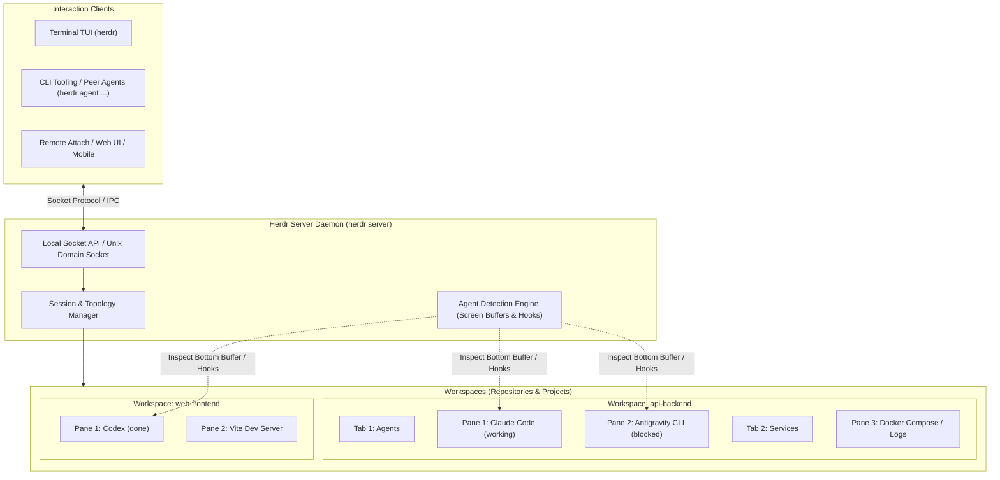
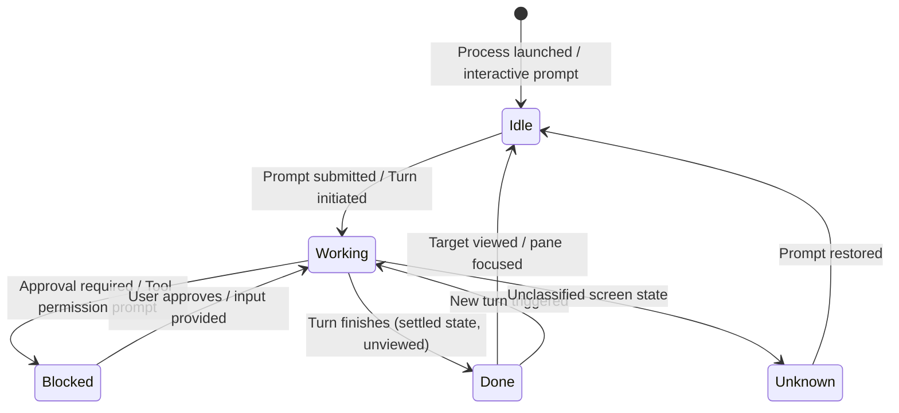

# Herdr Overview & Agent Multiplexer Architecture

## 1. What is Herdr?

**Herdr** is an open-source, mouse-first terminal workspace manager and session multiplexer built specifically for coordinating multiple AI coding agents (such as Claude Code, Codex, Antigravity CLI, OpenCode, Pi, and Hermes Agent).

Like traditional terminal multiplexers (`tmux`, `screen`, `zellij`), Herdr uses a client-server architecture: a long-running background daemon process owns real terminal pseudo-terminals (PTYs), while interactive terminal or GUI clients attach to render them. Running panes, background builds, test suites, and AI agent reasoning loops survive client detaches, network dropouts, and computer sleep cycles.

Unlike legacy multiplexers, Herdr is explicitly **agent-aware** and **mouse-first**:
1. **Agent Awareness**: Herdr inspects running processes and terminal bottom buffers to classify the real-time operational status of coding agents (`idle`, `working`, `blocked`, `done`, `unknown`), rolling those statuses up into a live project sidebar.
2. **Mouse-First TUI**: All panes, tabs, workspaces, and split dividers can be clicked, dragged, and context-clicked via native terminal mouse protocols without memorizing complex key sequences.
3. **Programmatic Socket & CLI Surface**: An integrated Unix Domain Socket / Windows Named Pipe API and full-featured CLI allow external scripts, CI pipelines, and peer agents to inspect, split, prompt, and orchestrate other agents deterministically using JSON responses.



---

## 2. Core Concepts & Primitives

Herdr organizes terminal execution into five distinct hierarchical primitives:

| Primitive | Scope | Lifecycle & Persistence | Description |
|---|---|---|---|
| **Session** | Global Daemon Namespace | Persistent across clients | Represents an independent Herdr runtime server instance. Running `herdr` connects to the `default` session. Named sessions (e.g., `herdr session attach work`) maintain isolated workspaces, sockets, and panes. |
| **Workspace** | Project / Repository Container | Scoped to a Session | The top-level project container. Typically corresponds to a distinct Git repository or root directory. The sidebar rolls agent statuses up per workspace. |
| **Tab** | Visual Layout | Scoped to a Workspace | Organizes panes within a workspace (e.g., `agents`, `logs`, `server`). Has its own split topology. |
| **Pane** | Terminal PTY Container | Scoped to a Tab | A real terminal pseudo-terminal hosting a shell or running process. Can be split horizontally (`down`) or vertically (`right`). Panes exist independently of whether an agent is active inside them. |
| **Agent** | Recognized Coding Process | Scoped to a Pane | An AI coding process detected or reported inside a pane. Tracks turns, lifecycle states, and resume identifiers. |

### Identifier Scheme
Herdr generates opaque, stable handles for its primitives:
- **Workspace ID**: `w1`, `w2`, ...
- **Tab ID**: `w1:t1`, `w1:t2`, ...
- **Pane ID**: `w1:p1`, `w1:p2`, ...

Closed tab and pane IDs are never reused in the same session. When a pane is moved across workspaces via `pane move`, it receives a new workspace-qualified pane ID.

Inside each managed pane, Herdr injects caller context into the environment:
```bash
printf '%s\n' "$HERDR_WORKSPACE_ID" "$HERDR_TAB_ID" "$HERDR_PANE_ID"
```

---

## 3. Agent Lifecycle States

Herdr continuously tracks and exposes the exact lifecycle state of every detected agent. These states allow humans and orchestrating scripts to immediately determine which agent requires attention without manually switching across dozens of terminals.



### The 5 Canonical Agent States

1. **`idle`**:
   - **Meaning**: The agent process is in the foreground, at an interactive prompt, and ready for user or automation input.
   - **Characteristics**: No active thinking, generation, or tool execution is occurring.
   - **Note**: In agents with background tasks or subagent capabilities (such as Antigravity CLI or Grok CLI), returning to the CLI prompt registers as `idle` even if asynchronous subagents or background monitors remain active.

2. **`working`**:
   - **Meaning**: The agent is actively generating text, reasoning, querying an LLM provider, running a shell command, or executing a tool.
   - **Characteristics**: Input sent to the pane during this state may be buffered or ignored depending on the agent's input mode.

3. **`blocked`**:
   - **Meaning**: The agent is halted waiting for human approval, confirmation, or interactive question answering (e.g., approving a dangerous command execution, granting file write permissions, or selecting from a multiple-choice menu).
   - **Characteristics**: Detection is strictly guarded by screen manifest rules. If an unrecognized prompt appears, Herdr defaults to `idle` (`default_known_agent_idle_fallback`) to avoid false-positive blocking halts.

4. **`done`**:
   - **Meaning**: The agent completed its requested task and transitioned to ready-for-input, but the completion has not yet been viewed/focused by the human operator.
   - **Characteristics**: The CLI and socket API distinguish `done` from `idle` using server-side "seen" flags. Explicit focus commands (`pane focus`, `agent focus`) mark the target as seen, converting `done` to `idle`. Each connected TUI client maintains independent viewed-badge tracking.

5. **`unknown`**:
   - **Meaning**: A recognized agent executable is detected in the process table, but Herdr's classification engine cannot match the live screen output against known working, blocked, or idle patterns.
   - **Characteristics**: Does **not** indicate successful completion. Scripts should inspect `herdr agent get <name>` or `herdr agent read <name>` before attempting to send input.

---

## 4. State Detection Engine: How Herdr Detects Agents

Herdr discovers agent states through a hybrid architecture combining process inspection, screen-manifest pattern matching, and native agent hook integrations:

### 1. Process Inspection
Herdr tracks the foreground process group of each pane's PTY:
- On Linux and macOS, it inspects `/proc` or system process tables to identify recognized binaries (`claude`, `codex`, `agy`, `opencode`, etc.).
- In containerized or restricted Linux environments where terminal foreground process groups are hidden, setting `HERDR_PROCESS_DETECTION=child-groups` enables child-process-group inference.
- When container wrappers (e.g., `fence`, `nono`, Docker runners) obscure the real process, the caller can explicitly hint the agent identity using `HERDR_AGENT=<agent_name>` (e.g., `HERDR_AGENT=claude nono run -- claude`).

### 2. Screen-Manifest Pattern Matching
For agents without built-in state reporting (including Claude Code, Codex, and Grok CLI), Herdr captures the **bottom-buffer snapshot** (the active rendered viewport bottom lines, ignoring historical scrollback).
- Rules compiled into Herdr's agent detection manifests evaluate ANSI escape sequences, regex patterns, and text boundaries.
- Live manifests can be inspected and updated dynamically via:
  ```bash
  herdr server agent-manifests
  herdr server update-agent-manifests
  herdr agent explain <agent-name> --verbose
  ```

### 3. Native Agent Integrations & Hooks
Certain agents report their lifecycle directly to Herdr's local socket API:
- Agents with native client-side reporting: **OpenCode**, **Pi**, **OMP**, **Kimi Code CLI**, **Kilo Code CLI**, and **MastraCode**. When these agents report state, Herdr prioritizes their direct signals over bottom-buffer heuristics.
- Session-restoration hooks: Integrations for **Claude Code** (`~/.claude/hooks/herdr-agent-state.sh`) and **Antigravity CLI** (`~/.gemini/config/hooks/herdr-agent-state.sh`) report session IDs to Herdr on `SessionStart` / `PreInvocation`. When Herdr restarts or recovers from a machine reboot, it automatically invokes `claude --resume <id>` or `agy --conversation <id>` to restore exact session context.

---

## 5. Interaction Modes & Navigation

Herdr provides three primary interaction surfaces:

1. **Terminal Mode (Direct Pass-Through)**:
   - Keystrokes pass directly to the focused pane PTY. Full support for mouse scrolling, mouse clicks, and terminal graphics.
2. **Prefix Mode (`ctrl+space` or `ctrl+b`)**:
   - Pressing the prefix key (configurable in `~/.config/herdr/config.toml`, user default is `ctrl+space`) followed by a single command key triggers a Herdr action (e.g., `prefix+c` for new tab, `prefix+v` for vertical split, `prefix+a` to cycle active agents).
3. **Navigate Mode**:
   - A modal navigation layer allowing arrow-key traversal across workspaces, tabs, and panes without mouse interaction.

---

## 6. Why Herdr for AI Coding Agents?

Running AI coding agents inside standard terminal windows or basic IDE panels introduces severe operational bottlenecks:
- **Lid-Close Termination**: When a developer's laptop sleeps or disconnects from Wi-Fi, long-running agent tasks running locally abort.
- **Context Blindness**: Running 5-10 agents in separate tabs requires manual, constant checking of each terminal to see if an agent is done or asking for permission.
- **Lost Agent History**: Process crashes or container restarts erase the active conversation handle.
- **Lack of Programmatic Control**: Peer agents cannot inspect or coordinate other agents without direct terminal multiplexing primitives.

Herdr eliminates these pain points by decoupling terminal execution into persistent background sessions, surfacing universal agent states, and providing an API for human and machine operators alike.
