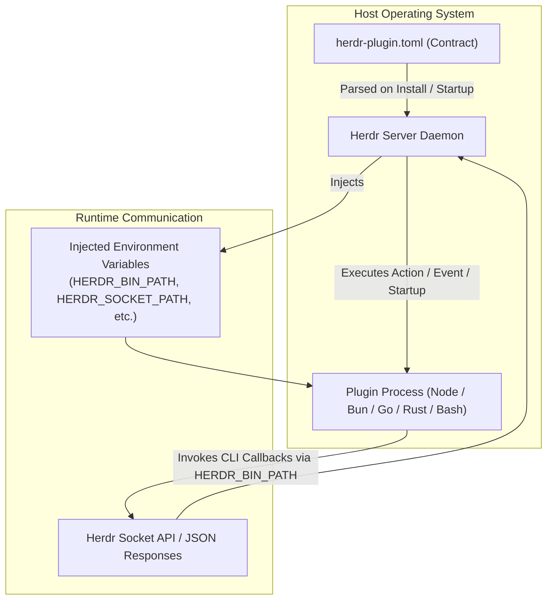
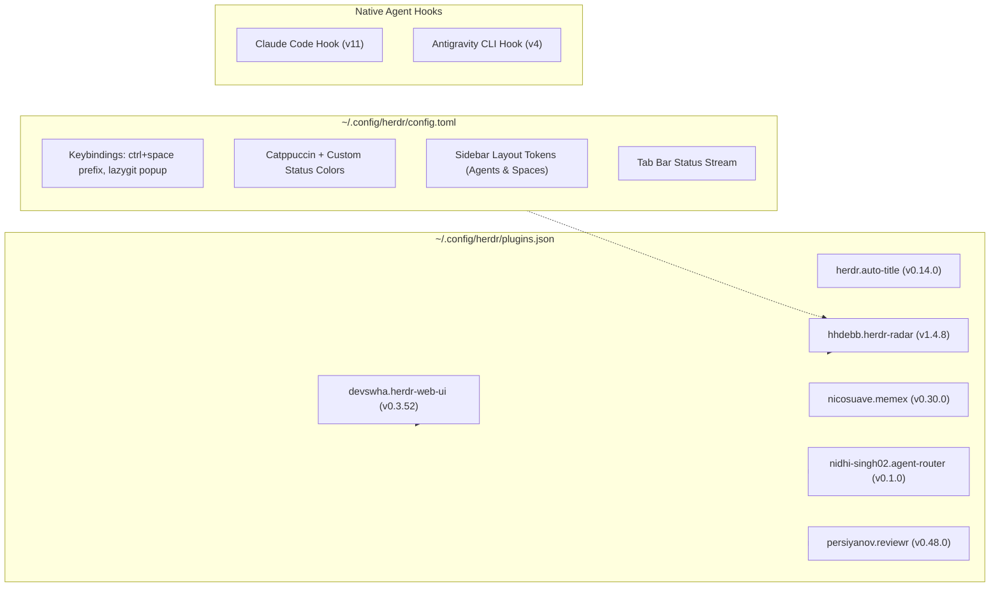

# Herdr Plugins & Extensions Catalog

## 1. Plugin Architecture & Security Model

Herdr features a decoupled, language-agnostic plugin architecture. Rather than relying on an in-process JavaScript/Wasm sandbox or restricted runtime SDK, a Herdr plugin is an ordinary directory containing a declarative manifest file (`herdr-plugin.toml`) and executable commands that Herdr spawns as native child processes (`argv` arrays).



### The Manifest Contract (`herdr-plugin.toml`)
The plugin contract defines metadata, build scripts, startup daemons, user-facing actions, lifecycle events, and terminal UI panes:

```toml
plugin_id = "author.plugin-name"
name = "Plugin Display Name"
version = "1.0.0"
min_herdr_version = "0.9.0"
description = "Description of capabilities"

[[build]]
command = ["bun", "run", "build"]

[[startup]]
command = ["./bin/daemon"]

[[actions]]
id = "launch"
title = "Launch Feature"
contexts = ["workspace", "pane", "global"]
command = ["./bin/cli", "launch"]

[[events]]
on = "worktree.created"
command = ["./bin/cli", "--auto-open"]

[[panes]]
id = "ui"
title = "Plugin UI"
placement = "split" # overlay | popup | split | tab | zoomed
command = ["./bin/tui"]
```

### Injected Runtime Environment Variables
When launching plugin actions, startup scripts, or panes, Herdr automatically injects the following context variables:

| Variable | Purpose |
|---|---|
| `HERDR_BIN_PATH` | Path to the authoritative `herdr` binary for issuing CLI callbacks. |
| `HERDR_SOCKET_PATH` | Path to the local Unix domain socket / named pipe. |
| `HERDR_ENV` | Set to `1` indicating execution under Herdr. |
| `HERDR_PLUGIN_ID` | The registered identifier (e.g. `hhdebb.herdr-radar`). |
| `HERDR_PLUGIN_ROOT` | Path to the checkout directory where the plugin is cloned. *(Replaced on upgrade!)* |
| `HERDR_PLUGIN_CONFIG_DIR` | User-owned directory (`~/.config/herdr/plugins/<id>/`) that survives re-installs. |
| `HERDR_PLUGIN_STATE_DIR` | Local state directory (`~/.local/state/herdr/plugins/<id>/`) for caches and data. |
| `HERDR_PLUGIN_CONTEXT_JSON` | Serialized JSON containing caller context (`workspace_id`, `pane_id`, `cwd`). |

> [!CAUTION]
> **No Sandbox Warning**: A Herdr plugin runs with your user's full permissions and environment variables. A rogue plugin can read your SSH keys, AWS credentials, or agent API tokens. Never install plugins with `--yes` without reviewing their manifest and scripts.

---

## 2. 5-Minute Plugin Vetting & Operational Lifecycle

### 2.1 The Vetting Checklist
Before installing any community plugin from GitHub or `herdr.dev/plugins`:
1. **Inspect `herdr-plugin.toml`**: Read every `[[build]]`, `[[startup]]`, `[[actions]]`, and `[[events]]` command array.
2. **Scrutinize Shell Wrappers**: Treat raw `["bash", "-c", "..."]` strings with suspicion compared to direct binary arrays `["node", "index.js"]`.
3. **Verify File Access**: Skim scripts for accesses to `~/.ssh`, `~/.aws`, `~/.config`, or agent credential paths.
4. **Pin Git Tags**: Always specify `--ref <tag>` to prevent upstream branch changes from mutating your installation.

### 2.2 Plugin Management Commands

```bash
# Install with interactive preview and pinned ref
herdr plugin install owner/repo --ref v1.2.0

# Local development: link an unmanaged local directory (no build step)
herdr plugin link /Users/amgreer/src/my-plugin

# Inspect registered plugins and actions
herdr plugin list --json
herdr plugin action list --plugin author.plugin-name

# Invoke an action programmatically
herdr plugin action invoke author.plugin-name.action_id

# Inspect plugin execution logs (stdout/stderr)
herdr plugin log list --plugin author.plugin-name --limit 25

# Disable, enable, or uninstall
herdr plugin disable author.plugin-name
herdr plugin enable author.plugin-name
herdr plugin uninstall author.plugin-name # Wipes checkout, preserves CONFIG_DIR
```

---

## 3. Top Community Ecosystem Plugins (Vetted Picks)

A curated selection of the 10 most impactful plugins available in the Herdr ecosystem:

| Plugin | Repository | Category | Description |
|---|---|---|---|
| **herdr-reviewr** | `persiyanov/herdr-reviewr` | Agent Review | Split-pane git diff viewer that allows line-by-line commenting directly fed into agent input prompts. |
| **herdr-file-viewer** | `smarzban/herdr-file-viewer` | Inspection | Read-only file tree TUI with syntax highlighting and working-tree diff tracking. |
| **zoetrope** | `furkankly/zoetrope` | Visualization | Visual flow graph depicting active agent turns, subagents, and decision trees in real time. |
| **herdr-agent-usage** | `levi-qiao/herdr-agent-usage` | FinOps / Quota | Tracks credential-scoped token consumption, cache hit ratios, and estimated API costs across providers. |
| **herdr-plus** | `cloudmanic/herdr-plus` | Workspace | Bootstraps multi-tab, multi-pane workspaces declaratively from committed project TOML files. |
| **herdr-auto-title** | `kryptamine/herdr-auto-title` | Productivity | Dynamically names tabs and panes based on active Git branch, running commands, and agent context. |
| **herdr-navigator** | `thanhdat77/herdr-navigator` | Navigation | Fuzzy jumper popup matching across workspaces, remotes, projects, directories, and agents. |
| **herdr-resurrect** | `ntindle/herdr-resurrect` | Disaster Recovery | Takes periodic snapshots of layouts, cwds, and agent handles; restores state after machine crashes or reboots. |
| **herdr-plugin-manager** | `speardragon/herdr-plugin-manager` | Management | Interactive in-TUI popup for discovering, installing, and managing plugins without shell commands. |
| **collie** | `AltanS/collie` | Remote / Mobile | Self-hosted mobile PWA client allowing control and notification approvals over Tailscale. |

---

## 4. Deep Dive: Active Local Plugins & Custom Configurations

This section details the active plugins and agent integrations configured on this system (`/Users/amgreer/.config/herdr/`).



---

### 4.1 `hhdebb.herdr-radar` (v1.4.8)
- **Source**: `hhdebb/herdr-radar` (managed GitHub installation)
- **Role**: Enhanced agent status radar. Groups agents by project, renders vendor logos and brand colors, nests git worktrees under repositories, and dims idle sessions.
- **Local State**: Outputs live status text to `/Users/amgreer/.local/state/herdr/plugins/hhdebb.herdr-radar/tabbar.txt`.
- **Active Configuration in `config.toml`**:
  ```toml
  # Tab bar integration: reads radar state every 6 seconds
  tab_bar_right = [
    { type = 'command', command = 'cat "/Users/amgreer/.local/state/herdr/plugins/hhdebb.herdr-radar/tabbar${HERDR_SESSION:+-$HERDR_SESSION}.txt"', interval_seconds = 6, timeout_seconds = 2 },
  ]

  # Custom vendor color definitions for agent working states:
  # - Claude: #d97757 (orange-tan)
  # - Gemini: #4285f4 (Google blue)
  # - Kimi:   #1783ff (bright blue)
  # - Qwen:   #615ced (indigo)
  # - Kiro:   #9046ff (purple)
  # - Cline:  #586876 (slate grey)
  ```
- **Actions**:
  - `configure`: Installs managed sidebar and tab-bar blocks into `config.toml`.
  - `install-font`: Copies dedicated glyph font to user font directory for agent vendor logos.
  - `view-flip`: Toggles between grouped-by-activity and flat-by-activity views.

---

### 4.2 `devswha.herdr-web-ui` (v0.3.52)
- **Source**: Local link (`/Users/amgreer/src/herdr-web-ui`)
- **Role**: Full-featured web and mobile client for Herdr. Exposes chat and live terminal streaming for every agent pane, bridges remote SSH machines, and delivers web push alerts.
- **Runtime**: Built with **Bun** (`bun install`, `bun run build`).
- **Actions & Panes**:
  - `start` / `stop` / `status`: Lifecycle control for the web daemon via `bun scripts/plugin.ts`.
  - `phone`: Opens a zoomed QR setup pane for pairing mobile devices over the local network or tunnel.

---

### 4.3 `persiyanov.reviewr` (v0.48.0)
- **Source**: `persiyanov/herdr-reviewr` (managed GitHub installation)
- **Role**: Side-by-side agent diff reviewer. Intercepts code written by Claude Code, Codex, or Antigravity CLI and renders a split diff pane where comments can be typed on specific lines and injected directly into the agent's input stream.
- **Event-Driven Hooks**:
  ```toml
  [[events]]
  on = "worktree.created"
  command = ["bin/herdr-reviewr", "--action", "auto-open"]

  [[events]]
  on = "worktree.opened"
  command = ["bin/herdr-reviewr", "--action", "auto-open"]
  ```
  Whenever a new git worktree is spawned for an agent, Reviewr automatically splits the layout and attaches the diff viewer.

---

### 4.4 `nicosuave.memex` (v0.30.0)
- **Source**: `nicosuave/memex` (managed GitHub installation)
- **Role**: Cross-agent session history desk. Indexes past conversations and sessions across Claude Code, Codex, Cursor, and Pi, allowing instantaneous search and resumption into a Herdr tab.
- **Key Actions**:
  - `memex: session desk`: Full zoomed session exploration dashboard.
  - `memex: session palette`: Fast overlay modal for jumping into previous chats.
  - `memex: resume-last`: Immediately resumes the most recent conversation in the current repo.

---

### 4.5 `nidhi-singh02.agent-router` (v0.1.0)
- **Source**: Local link (`/Users/amgreer/src/agent-router-jpl`)
- **Role**: Quota-aware agent routing engine. Inspects current API quotas across multiple accounts and models, calculates task effort, and automatically selects and launches the optimal agent into a newly split Herdr pane.
- **Actions**:
  - `Router: route a task`: Interactive overlay prompting for a prompt/task, scoring model options, and launching the agent.
  - `Router: refresh usage`: Queries upstream LLM provider APIs to update local quota snapshots.

---

### 4.6 `herdr.auto-title` (v0.14.0)
- **Source**: `kryptamine/herdr-auto-title` (managed GitHub installation)
- **Role**: Contextual tab and pane naming. Automatically renames tabs (e.g. `claude:oauth-fix`, `codex:test-runner`) by analyzing git branch state and active agent sessions.
- **Runtime**: Compiled Go binary (`herdr-auto-title`), runs continuously in the background.

---

## 5. Native Agent Integrations

In addition to community plugins, Herdr maintains first-party shell hooks for coding agents to manage session persistence across server handoffs:

### Claude Code Integration (v11)
- **Hook Location**: `/Users/amgreer/.claude/hooks/herdr-agent-state.sh`
- **Mechanism**: Registered in `settings.json` under `SessionStart`. Fires on `startup`, `resume`, `clear`, `compact`, and `fork`.
- **Function**: Reports Claude's unique session identifier to Herdr's local socket. If the Herdr server restarts, Herdr resumes the exact session using `claude --resume <session_id>`. State classification (`working`, `idle`, `blocked`) is evaluated via screen detection manifests.

### Antigravity CLI Integration (v4)
- **Hook Location**: `/Users/amgreer/.gemini/config/hooks/herdr-agent-state.sh`
- **Mechanism**: Configured in `hooks.json` under the `herdr` namespace, triggered on `PreInvocation`.
- **Function**: Captures the active conversation identifier when prompts are submitted. When Herdr reboots, it restores the pane using `agy --conversation <id>`.
