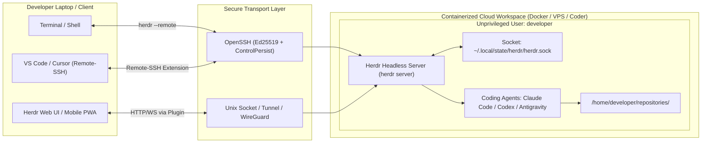
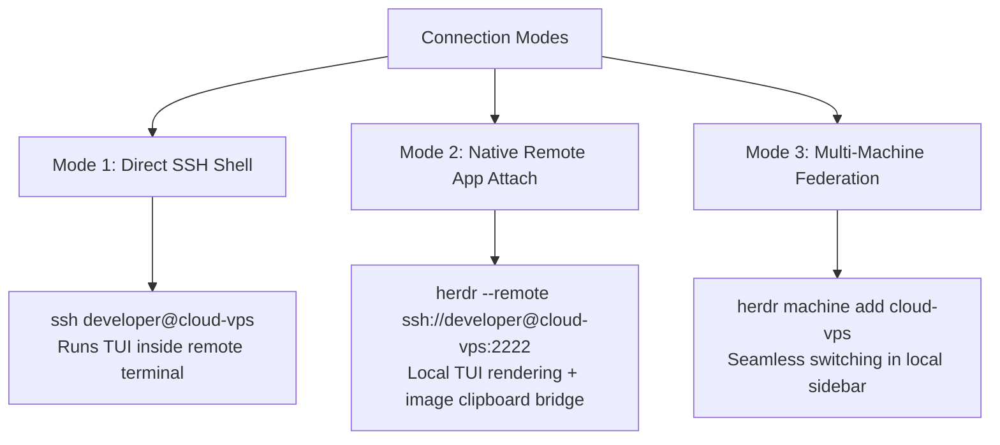

# Containerized & Cloud Workspace Deployment Guide

> [!IMPORTANT]
> **Scope Notice**: This deployment guide focuses exclusively on **containerized and cloud workspace deployments** (Docker, Docker Compose, Coder, and cloud-hosted VPS containers). Native local desktop installations are deliberately omitted.

---

## 1. Cloud & Container Architecture Overview

When deploying AI coding agents at scale, running them in ephemeral local laptop terminals creates single points of failure: laptop sleep cycles abort long-running tasks, network changes terminate SSH pipes, and agent shell scripts execute with broad host permissions.

Herdr resolves this by decoupling the **compute and process layer** (running inside a containerized cloud environment) from the **presentation and control layer** (running on your client machine or browser).



### Key Security & Operational Principles
1. **Unprivileged Execution**: Agents execute shell commands, install dependencies, and build code. They must **never** run as `root`. The container runs as a dedicated `developer` user without sudo privileges.
2. **Persistence Over Disconnects**: The headless daemon `herdr server` owns all PTY terminals. When your laptop sleeps or your SSH connection drops, agent reasoning loops and build tasks continue uninterrupted.
3. **Firewall & Ingress Isolation**: Remote workspaces accept inbound SSH traffic strictly from trusted public IPs or VPN interfaces (WireGuard / Tailscale). All other ports remain closed to the public internet.

---

## 2. Container Blueprint (Dockerfile & Compose)

Below is an enterprise-grade Docker container definition for a headless Herdr agent workspace.

### 2.1 Container `Dockerfile`

```dockerfile
# syntax=docker/dockerfile:1.4
FROM ubuntu:24.04

# Prevent interactive prompts during package install
ENV DEBIAN_FRONTEND=noninteractive
ENV SHELL=/bin/bash

# Install system dependencies, OpenSSH server, Git, and build toolchains
RUN apt-get update && apt-get install -y --no-install-recommends \
    apt-transport-https \
    ca-certificates \
    curl \
    git \
    gnupg \
    jq \
    locales \
    openssh-server \
    procps \
    python3 \
    python3-pip \
    sudo \
    unzip \
    zsh \
    && rm -rf /var/lib/apt/lists/*

# Set up locale
RUN locale-gen en_US.UTF-8
ENV LANG=en_US.UTF-8
ENV LC_ALL=en_US.UTF-8

# Create unprivileged daily user 'developer'
RUN useradd -m -s /bin/bash -u 1000 developer \
    && mkdir -p /home/developer/.ssh /home/developer/repositories /home/developer/.config/herdr /home/developer/.local/state/herdr \
    && chown -R developer:developer /home/developer

# Configure OpenSSH Server
RUN mkdir -p /var/run/sshd \
    && sed -i 's/#PasswordAuthentication yes/PasswordAuthentication no/' /etc/ssh/sshd_config \
    && sed -i 's/#PubkeyAuthentication yes/PubkeyAuthentication yes/' /etc/ssh/sshd_config \
    && sed -i 's/#KexAlgorithms .*/KexAlgorithms curve25519-sha256,curve25519-sha256@libssh.org/' /etc/ssh/sshd_config

# Install Herdr binary globally
RUN curl -fsSL https://herdr.dev/install.sh | sh \
    && mv /root/.local/bin/herdr /usr/local/bin/herdr \
    && chmod +x /usr/local/bin/herdr

# Install GitHub CLI (gh)
RUN curl -fsSL https://cli.github.com/packages/githubcli-archive-keyring.gpg | dd of=/usr/share/keyrings/githubcli-archive-keyring.gpg \
    && chmod go+r /usr/share/keyrings/githubcli-archive-keyring.gpg \
    && echo "deb [arch=$(dpkg --print-architecture) signed-by=/usr/share/keyrings/githubcli-archive-keyring.gpg] https://cli.github.com/packages stable main" | tee /etc/apt/sources.list.d/github-cli.list > /dev/null \
    && apt-get update && apt-get install -y github-cli && rm -rf /var/lib/apt/lists/*

# Install Node.js & Bun for agent execution & plugins
RUN curl -fsSL https://deb.nodesource.com/setup_22.x | bash - \
    && apt-get install -y nodejs \
    && npm install -g @anthropic-ai/claude-code \
    && rm -rf /var/lib/apt/lists/* \
    && curl -fsSL https://bun.sh/install | bash \
    && mv /root/.bun/bin/bun /usr/local/bin/bun

# Switch to developer user for agent configurations
USER developer
WORKDIR /home/developer

# Set mandatory container environment variables
ENV HERDR_ENV=1
ENV HERDR_PROCESS_DETECTION=child-groups
ENV PATH="/home/developer/.local/bin:/usr/local/bin:${PATH}"

# Install agent integrations
RUN herdr integration install claude || true

# Expose SSH
EXPOSE 2222

# Entrypoint launches SSH daemon and the persistent headless Herdr server
CMD ["sudo", "/usr/sbin/sshd", "-D", "-p", "2222"]
```

---

### 2.2 Container Orchestration (`docker-compose.yml`)

```yaml
version: "3.8"

services:
  agent-workspace:
    build:
      context: .
      dockerfile: Dockerfile
    container_name: agent-workspace
    restart: unless-stopped
    ports:
      - "127.0.0.1:2222:2222" # Bind SSH strictly to localhost or VPN interface
    environment:
      - HERDR_ENV=1
      - HERDR_PROCESS_DETECTION=child-groups
      - HERDR_CONFIG_PATH=/home/developer/.config/herdr/config.toml
    volumes:
      # Persistent configuration & runtime state
      - herdr_config:/home/developer/.config/herdr
      - herdr_state:/home/developer/.local/state/herdr
      # Persistent agent credentials & caches
      - agent_claude:/home/developer/.claude
      - agent_gemini:/home/developer/.gemini
      - agent_codex:/home/developer/.codex
      # SSH Authorized keys for laptop access
      - ./authorized_keys:/home/developer/.ssh/authorized_keys:ro
      # Code repositories
      - ./repositories:/home/developer/repositories
    security_opt:
      - no-new-privileges:true

volumes:
  herdr_config:
  herdr_state:
  agent_claude:
  agent_gemini:
  agent_codex:
```

---

## 3. Environment Variables & Socket Configuration

Containers have unique process group and isolation characteristics. Configure the following environment variables inside your container or Coder workspace template:

| Environment Variable | Recommended Container Value | Description |
|---|---|---|
| `HERDR_ENV` | `1` | Informs processes that they are operating inside a Herdr-managed pane. Essential for CLI and agent auto-detection. |
| `HERDR_PROCESS_DETECTION` | `child-groups` | In container environments, Docker often prevents direct access to terminal foreground process groups. Setting `child-groups` enables child-process inference so Herdr can detect running agents inside nested shells. |
| `HERDR_SOCKET_PATH` | `/home/developer/.local/state/herdr/herdr.sock` | Explicit Unix domain socket path. Ensure this path resides on a writable, non-networked local volume. |
| `HERDR_CONFIG_PATH` | `/home/developer/.config/herdr/config.toml` | Path to persistent configuration file. |
| `HERDR_SESSION` | `default` | Designates the active named session namespace. |

### Socket API Inspection & Management

The running Herdr daemon exposes its local socket API. From inside the container, verify API health:

```bash
# Verify daemon status
herdr status server

# Export socket protocol schema for scripting or custom tools
herdr api schema --json > /home/developer/herdr-api.schema.json

# Live reload config without stopping agent panes
herdr server reload-config

# Fetch latest remote agent detection manifests
herdr server update-agent-manifests --json
```

---

## 4. Headless Server Daemon Operation (`herdr server`)

In containerized or cloud deployments where no interactive TUI client is initially attached, the background server is managed directly via `herdr server`:

### Starting Headless Herdr in Supervisors / Entrypoints
To launch the server in the background during container startup:

```bash
# Start the headless server explicitly
herdr server &

# Verify it is ready to receive requests
herdr status server
```

### Stopping or Restarting
When performing workspace maintenance:
```bash
# Gracefully stop the server daemon and its active panes
herdr server stop

# Reload agent detection manifests after local rule changes
herdr server reload-agent-manifests
```

> [!CAUTION]
> Never use `kill -9` or kill the server process abruptly. Running `herdr server stop` ensures that PTY state and workspace snapshots are committed to disk cleanly.

---

## 5. Remote Machine & SSH Attachment Workflows

Connecting from your laptop to the cloud container can be done via three primary workflows:



### 5.1 Mode 1: Direct SSH Shell (Classic Multiplexer)
SSH directly into the container and attach the interactive TUI:
```bash
ssh -p 2222 developer@agent-cloud
herdr
```
- Detach at any time using `ctrl+space q` or closing the terminal window.
- Reattaching restores all tabs, workspaces, and running agent processes exactly as left.

---

### 5.2 Mode 2: Native App Remote Attach (`herdr --remote`)
Run the client locally on your laptop, but execute all panes on the cloud container:
```bash
herdr --remote ssh://developer@agent-cloud:2222
```
**Benefits**:
- **Local Theme & Keybindings**: Uses your local laptop's `config.toml` keybindings, avoiding remote latency.
- **Image Clipboard Forwarding**: Copying an image locally and pressing paste inside an agent pane automatically transfers the image to a remote temp file and injects the remote path into the agent prompt.
- **Reduced Bandwidth**: Only session state and viewport deltas are streamed over SSH.

---

### 5.3 Mode 3: Multi-Machine Federation (`herdr machine`)
Manage multiple cloud containers (e.g., staging, production, evaluation) from one single Herdr client:

```bash
# Add a cloud container to your local Herdr client
herdr machine add agent-cloud --remote-session default

# List active profiles
herdr machine list --json

# Check connectivity and reachability
herdr machine status agent-cloud --json
```

Once added, the remote machine appears directly in your Herdr sidebar. You can switch between local workspaces and remote cloud workspaces with a single click.

#### Programmatic Remote Agent Coordination:
You can control agents running on the cloud container directly from your laptop CLI:
```bash
# Inspect running panes on the remote container
herdr --machine agent-cloud pane list

# Dispatch an instruction to a remote agent without opening the TUI
herdr --machine agent-cloud agent prompt reviewer "Run the full test suite and report failures." --wait --timeout 120000
```

---

### 5.4 Laptop OpenSSH Client Optimization

Add the following optimized block to your laptop's `~/.ssh/config`:

```ssh-config
Host agent-cloud
    HostName 198.51.100.45       # Replace with your Cloud VPS or WireGuard IP
    User developer
    Port 2222
    IdentityFile ~/.ssh/id_ed25519_agent_cloud
    IdentitiesOnly yes
    Compression yes               # Compresses screen update traffic
    ServerAliveInterval 30        # Prevents firewall timeout drops
    ServerAliveCountMax 5
    ControlMaster auto            # Connection multiplexing
    ControlPath ~/.ssh/sockets/%r@%h:%p
    ControlPersist 600            # Keeps connection warm for 10 minutes
```

---

## 6. Daily Operational Workflow

### Step 1: Connect & Verify
1. Ensure your VPN connection is active (if firewall restrictions are enabled).
2. Connect from your laptop:
   ```bash
   ssh agent-cloud
   herdr
   ```
3. Check the sidebar to see which agents finished tasks overnight (`done`) or need input (`blocked`).

### Step 2: Create a Workspace Per Repository
Organize each codebase into its own isolated Herdr workspace:
```bash
herdr workspace create --cwd ~/repositories/api-backend --label "api-backend"
```

### Step 3: Launch Agents in Sibling Panes
Within the workspace tab, split panes and launch agents:
```bash
# Split pane to the right
herdr pane split --current --direction right --cwd "$PWD" --no-focus

# Start Claude Code or Codex in the newly created pane
herdr agent start backend-coder --kind claude --pane w1:p2
```

### Step 4: Submit Work & Detach
Submit instructions to the agent:
```bash
herdr agent prompt backend-coder "Implement JWT authentication in /src/auth.ts and add tests." --wait
```
Detach from Herdr (`ctrl+space q`) or close your laptop lid. The container keeps the agent working in the cloud.

---

## 7. Connecting Cloud Workspaces to VS Code & Cursor

You can pair Herdr's terminal multiplexing with the editing power of VS Code or Cursor:

1. Install the **Remote - SSH** extension in VS Code / Cursor.
2. Press `Cmd+Shift+P` (or `Ctrl+Shift+P`), select **Remote-SSH: Connect to Host...**, and select `agent-cloud`.
3. Open the `/home/developer/repositories/` folder.
4. Open the integrated terminal inside VS Code and run `herdr`.
5. You now have full source code browsing, syntax highlighting, and Git diff viewing in VS Code, with all agent processes safely managed by Herdr on the cloud server.
